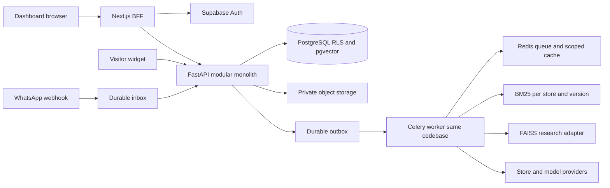
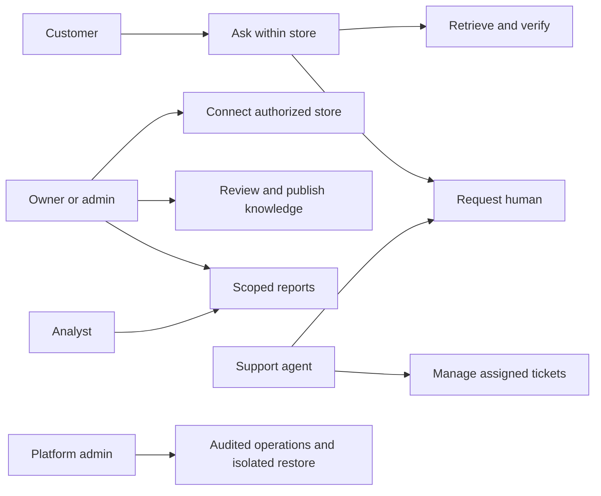
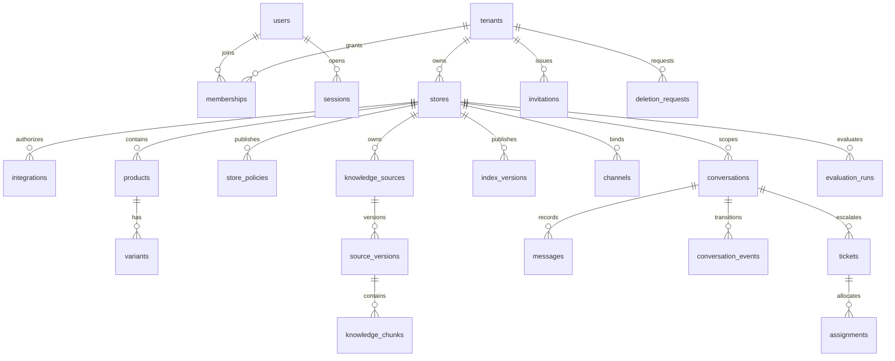
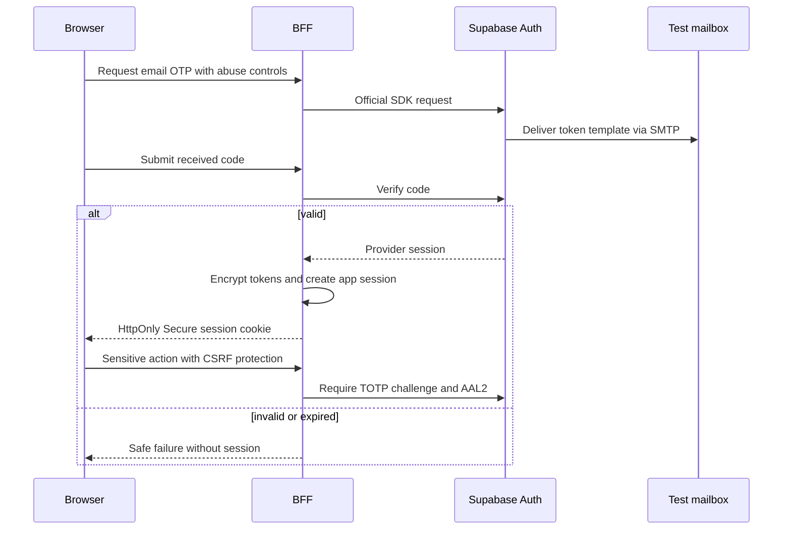
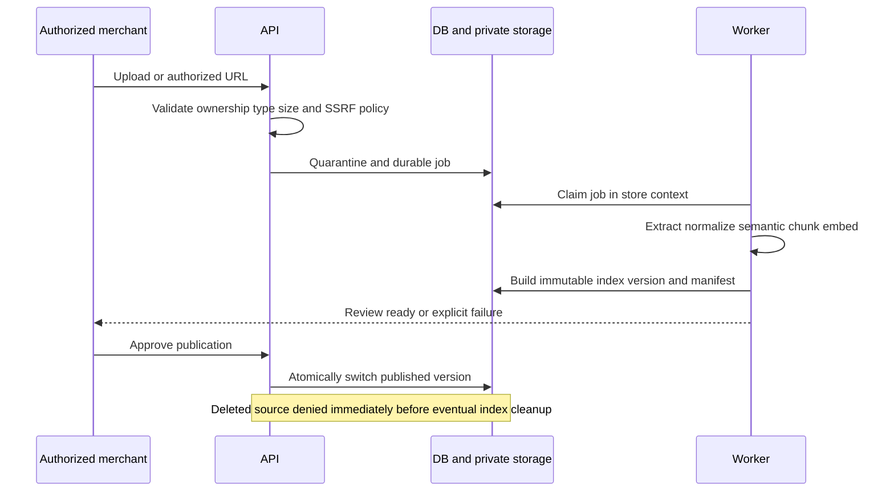
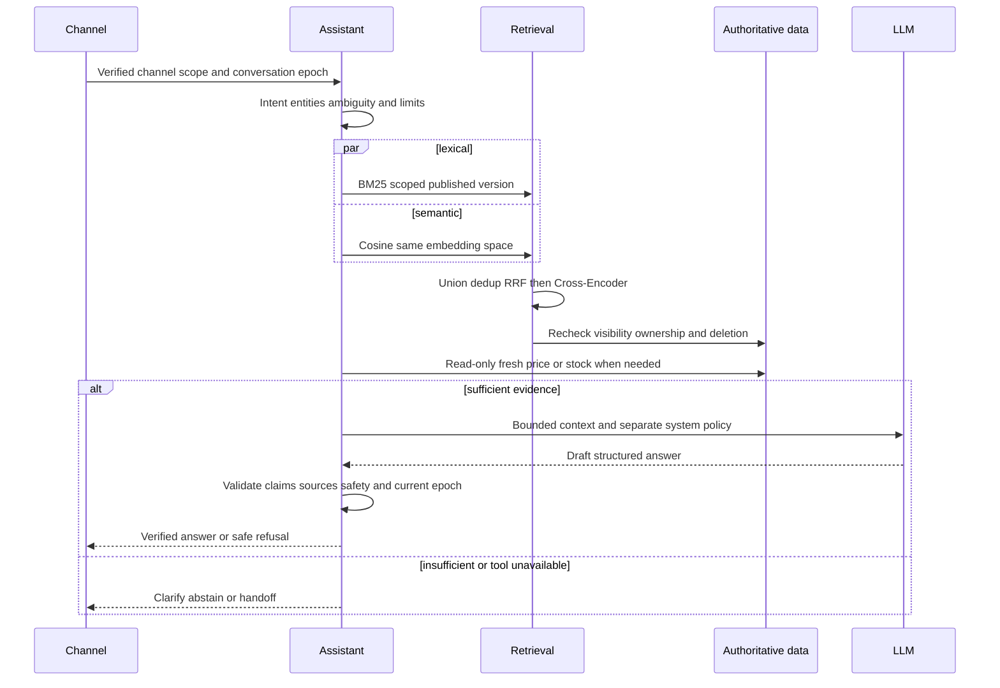
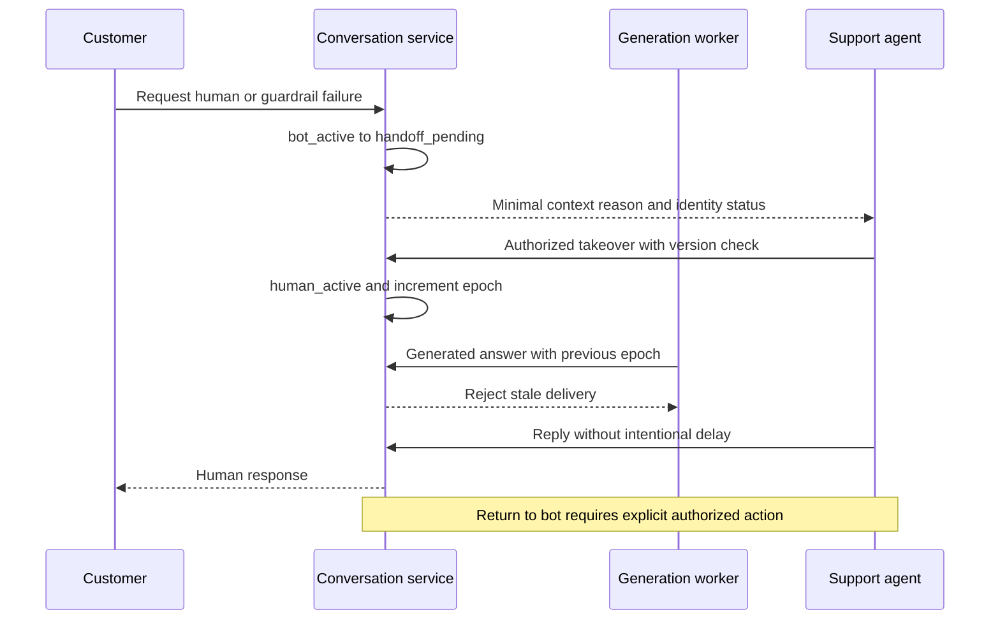

# البنية المقصودة ومخططات المرحلة 00

مخططات تصميم فقط. تفاصيل endpoint/scopes/signature للمزود لا تُحسم قبل وثائقه واختباره. API `/api/v1` وعقد OpenAPI واحد وعميل TS مولد؛ errors آمنة بـcode/trace_id؛ UUID/Decimal/UTC/pagination وحدود أحجام/idempotency. migrations تنشأ عند الحاجة في المراحل المالكة.

## المكونات



حدود الوحدات: identity/tenancy توفران سياق التفويض لبقية الوحدات؛ stores/catalog/integrations تملك الحقائق التشغيلية؛ knowledge تملك النشر والمصادر؛ retrieval يقرأ المنشور؛ assistant ينسق الأدوات والتحقق؛ conversations/channels/support تملك التسليم والتحويل؛ analytics/lifecycle/operations تتعامل بعقودها دون تجاوز العزل.

## حالات الاستخدام



## ERD أولي



كل علاقة مملوكة تُقيد بـtenant/store عبر مفاتيح مركبة وRLS؛ الرسم لا يغني عن DDL. index manifest يربط chunk IDs وإصدار المصدر/النموذج. webhook_inbox/outbox/sync_jobs/export_jobs/audit_events/usage_events/restore_jobs جداول تشغيل تنشأ عند الحاجة. users لا يحوي password_hash محليًا.

## Email OTP



## إدخال المعرفة



## سؤال RAG



## OAuth

```mermaid
sequenceDiagram
  participant U as Merchant
  participant B as Server
  participant P as Salla or Zid adapter
  participant D as DB
  U->>B: Connect authorized store
  B->>D: One-use state bound to session and tenant
  B-->>U: Provider authorization redirect
  U->>P: Provider consent
  P-->>B: Callback code and state
  B->>D: Atomically consume state and check binding
  B->>P: Server-side exchange per provider docs
  B->>D: Check store ownership and encrypt tokens
  B->>D: Enqueue initial sync through outbox
  Note over B,P: PKCE only if supported; no invented shared scopes or signatures
```

## التحويل البشري



## ??????? ?????? ?? ??????? 01

???????? ???????: apps/web ? packages/api-client ? FastAPI health/readiness? ??????? Celery ?? apps/api/src/store_advisor ????. Alembic ???? app ???? ?Supabase local ???? ?? ????? DB/Auth/Storage ?????? ???????. ????? ??????? users/tenants/memberships/stores? ???? ERD ????? ????? ????? ?????. RLS ??????? transaction-local ?????? ??? ???????? ??? DB ??? ?? ??? ???????. ?? ???? RAG ?? ???? ?? Auth endpoint ???? ??01. ?????? ?? ?????? ??? ???? ?? ?????01.
